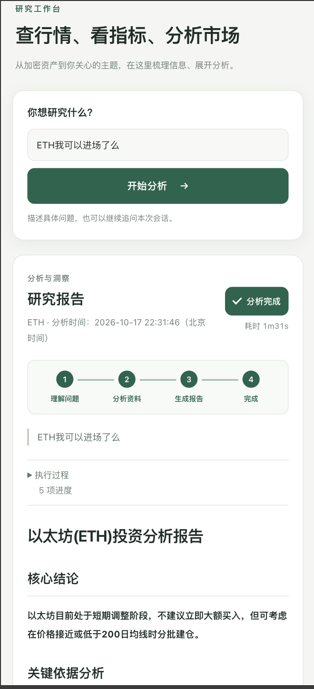
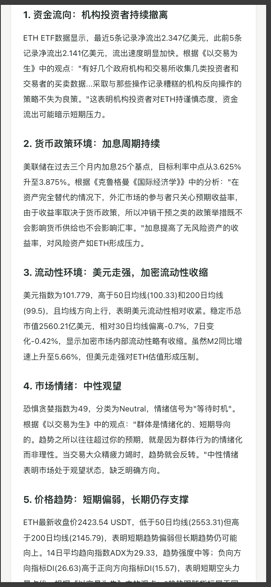
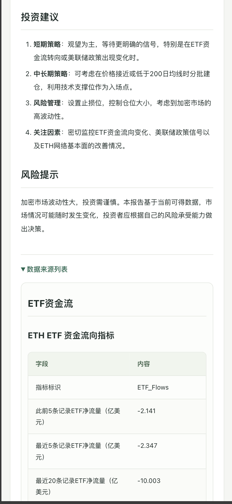
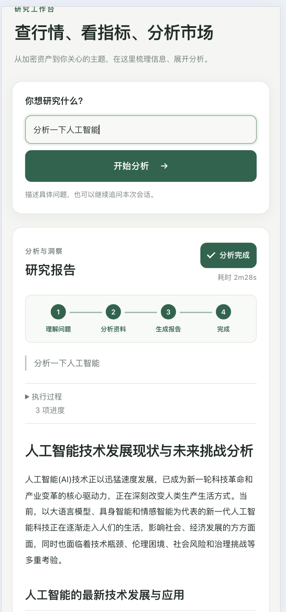
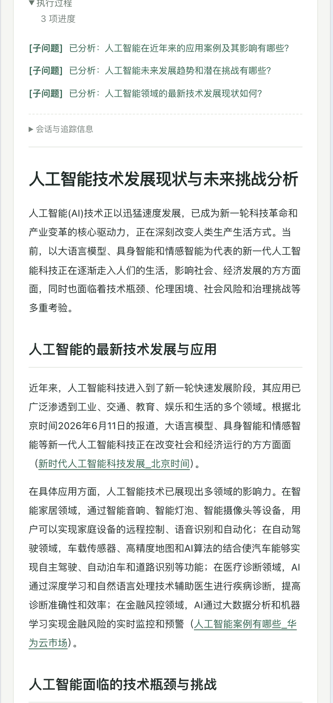
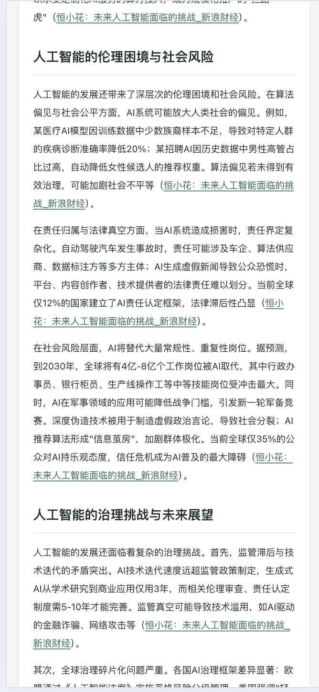
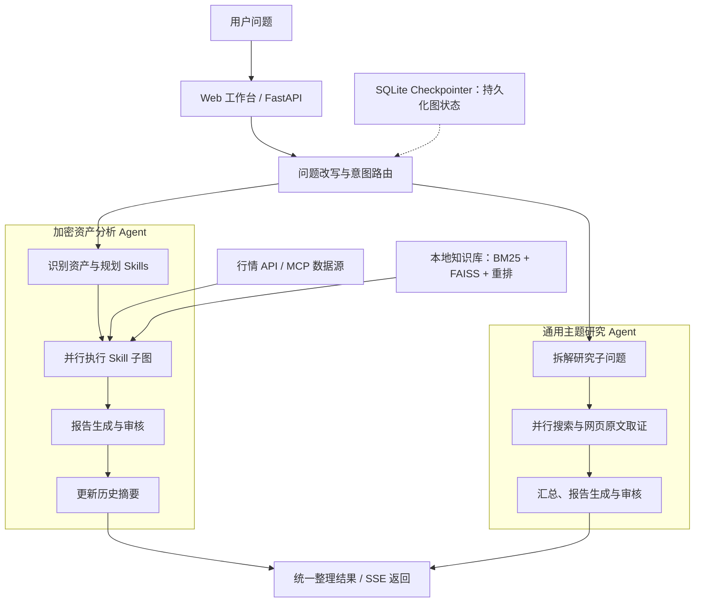
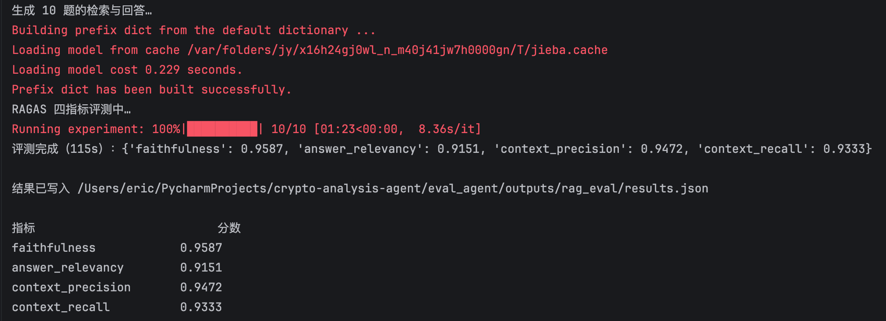

# Crypto Analysis Agent

基于 LangGraph 的加密资产分析与通用主题研究系统。

通过问题改写与意图路由，选择加密资产分析或通用主题研究 Agent，结合外部数据、网页原文和本地知识库，完成分析、报告生成与审核，并通过 Web 工作台展示执行阶段与研究结果。

**技术栈：** Python · FastAPI · LangChain · LangGraph · Pydantic · MCP · FAISS · SQLite · SSE

[功能与演示](#功能与演示) · [系统架构](#系统架构) · [核心设计](#核心设计) · [快速启动](#快速启动) · [评测与验证](#评测与验证) · [项目目录](#项目目录) · [当前范围](#当前范围)

## 功能与演示

### 加密资产分析

根据问题识别目标资产和分析维度，并行执行对应 Skills，获取指标、计算分数、检索分析材料，生成研究报告。

| 分析维度 | 主要内容 |
| --- | --- |
| 流动性 | 美元指数、M2、美联储资产负债表、稳定币市值 |
| 美联储政策 | 政策利率目标区间及其变化 |
| ETF 资金流 | 目标资产现货 ETF 净流量 |
| 衍生品 | 资金费率、未平仓合约等指标 |
| 趋势 | 价格、均线、ADX 与方向指标 |
| 市场情绪 | 恐惧贪婪指数及其分类 |

示例问题：

```text
分析 BTC 的趋势和衍生品指标，并说明当前信号的分歧。
结合流动性、美联储政策和 ETF 资金流，分析 BTC 的市场环境。
```

### 通用主题研究

将问题拆解为研究子问题，并行执行网页搜索和浏览器取证，再汇总发现、撰写报告并审稿。搜索摘要用于定位候选网页，详情页原文作为研究证据。

示例问题：

```text
研究 AI Agent 在企业知识管理中的应用场景、落地难点和适用边界。
比较向量检索与混合检索在中文知识库中的特点，给出资料来源。
```

### Web 工作台

工作台支持输入研究问题、查看执行进度、接收流式报告和查看数据来源。前端保留会话标识，供连续追问使用。

#### 加密资产分析示例

以下为一次 ETH 分析的实际运行截图，展示问题输入、执行阶段、报告正文及数据来源。点击图片可查看原图。

| 提问与执行进度 | 分析报告 | 数据来源与指标 |
| --- | --- | --- |
| <a href="docs/images/crypto-analysis-workbench.png"></a> | <a href="docs/images/crypto-analysis-report.png"></a> | <a href="docs/images/crypto-analysis-sources.png"></a> |

#### 通用主题研究示例

以“分析一下人工智能”为例，展示问题输入、三个研究子问题的执行情况，以及包含来源链接的研究报告。点击图片可查看原图。

| 提问与执行进度 | 子问题与研究汇总 | 报告正文与来源引用 |
| --- | --- | --- |
| <a href="docs/images/topic-research-workbench.png"></a> | <a href="docs/images/topic-research-subquestions.png"></a> | <a href="docs/images/topic-research-report.png"></a> |

## 系统架构



每轮请求只选择一个专家 Agent。两个专家使用独立的业务 State，共享外层会话持久化机制。

## 核心设计

### 先规划，再根据执行结果推进

加密资产分析先规划所需 Skills，再通过 LangGraph `Send` 并行执行。每个 Skill 子图先处理缓存、指标取数与计算、完整性检查，再生成指标内容与检索问题，将检索到的知识材料随 Skill 结果交给报告节点；指标执行结果决定是否继续工具调用。

通用主题研究先拆解问题，再由研究 Agent 根据搜索结果决定后续浏览与取证动作。这种方式结合了事前规划和执行过程中的反应式决策。

### Skills 与 Tools 分工

- **Skills**：定义分析场景、可用工具、指标要求、权重和解读方法，存放在 [skills/](skills/)。
- **Tools**：调用外部数据源并执行程序计算，记录原始值、计算值、来源、观察时间和缺失原因，存放在 [业务工具目录](app/crypto_analysis/tools/)。
- **Calculators**：执行确定性的指标计算与评分，存放在 [计算器目录](app/crypto_analysis/calculators/)。

模型负责规划、工具选择和解释；指标数值与分数由程序处理。

### RAG 与增量入库

Markdown 文档按标题结构与长度分块，保留文件名、章节路径、内容哈希和切片序号。入库时按文件哈希识别新增与修改，默认同步清理已删除文档对应的切片。

检索使用中文分词 BM25 和 FAISS 向量召回，通过加权融合及重排选择材料。加密分析中的知识材料用于支持指标解读；实时行情由数据源工具获取。

### 记忆与上下文

- 问题改写结合上一轮已完成的问题，补全连续追问。
- SQLite Checkpointer 持久化会话图状态，以 `thread_id` 隔离会话。
- 加密分析完成后更新历史摘要；同会话内按全局或资产范围复用 Skill 结果。

### 按节点配置模型

当前服务使用不同模型承担不同节点职责，具体名称以 [配置文件](app/core/config.py) 为准。

| 节点职责 | 模型配置项 | 当前代码默认值 |
| --- | --- | --- |
| 问题改写、路由、指标执行、检索问题生成、历史摘要、主题拆题与研究汇总 | `GLM_4_FLASH_MODEL` | `glm-4-flash` |
| 加密分析规划、报告写作与审核、检索多查询改写、主题研究的报告写作与审核 | `GLM_SMART_MODEL` | `glm-4.5-air` |
| 文档向量 | `EMBEDDING_MODEL` | `BAAI/bge-m3` |
| 检索重排 | `RERANK_MODEL` | `BAAI/bge-reranker-v2-m3` |

加密分析规划和检索多查询改写显式关闭 Air 的深度思考；报告写作与审核保留默认思考配置。

百炼模型另外用于独立 RAG 回答、部分图文处理和评测裁判。上述模型分工是代码中的节点配置，费用与延迟效果需通过具体运行记录验证。

### 日志、追踪与评测采集

业务日志携带 `trace_id` 和 `thread_id`；本地追踪器记录 Trace、Span、Generation、模型用量与估算成本。估算结果取决于配置的价格表。

节点候选采集保存 `node`、北京时间 `ts`、`input` 和 `actual_output`。人工筛选与标注后可用于固定用例回归。Langfuse 用于独立评测实验记录，业务追踪器本身不向 Langfuse 上报。

### 核心代码入口

| 模块 | 入口 |
| --- | --- |
| API 与依赖组装 | [api/main.py](api/main.py) |
| 问题改写与专家路由 | [app/routing/](app/routing/) |
| 分析规划、并行 Skill 与报告审核 | [crypto_analysis_parent_agent.py](app/crypto_analysis/crypto_analysis_parent_agent.py) |
| Skill 缓存、指标执行循环与内容生成 | [crypto_analysis_sub_agent.py](app/crypto_analysis/crypto_analysis_sub_agent.py) |
| 主题拆解、网页取证与报告生成 | [topic_research_agent.py](app/topic_research/topic_research_agent.py) |
| 检索与增量入库 | [app/rag/](app/rag/) |
| 模型创建与协议适配 | [app/llm/model.py](app/llm/model.py) |
| 日志、追踪与候选采集 | [app/core/](app/core/) |

## 快速启动

以下命令均在项目根目录执行。使用 Python 3.11，与 Docker 镜像保持一致；网页取证使用 Playwright Chromium。

### 1. 安装业务依赖

```bash
python3.11 -m venv .venv
source .venv/bin/activate
python -m pip install -r requirements.txt
python -m playwright install chromium
```

### 2. 配置环境变量

首次配置时复制示例，然后填写自己使用的服务密钥；已有 `.env` 时直接编辑原文件。

```bash
cp .env.example .env
```

[.env.example](.env.example) 只包含配置项和空密钥。当前主要配置如下：

| 环境变量 | 用途 | 使用条件 |
| --- | --- | --- |
| `SILICONFLOW_API_KEY` | Qwen 聊天、向量、重排 | 当前服务与知识入库需要 |
| `ZHIPUAI_4_API_KEY` | GLM 4 系列：主题研究、报告写作与审核 | 当前服务需要 |
| `ZHIPUAI_5_API_KEY` | GLM 5 系列模型 | 使用 5 系列模型时需要 |
| `BOCHA_API_KEY` | 网页搜索 | 通用主题研究需要 |
| `FRED_API_KEY` | 美联储政策及宏观序列 | 相关分析维度需要 |
| `CMC_PRO_API_KEY` | 稳定币市值与恐惧贪婪指数 | 相关分析维度需要 |
| `EODHD_API_KEY` | 通过 MCP 获取美元指数 | 流动性分析需要 |
| `CRYPTO_ETF_MCP_API_KEY` | 通过 MCP 获取现货 ETF 资金流 | ETF 分析需要 |
| `DASHSCOPE_API_KEY` | 百炼聊天、图文处理与裁判 | 独立 RAG 回答、相关入库或评测需要 |
| `LANGFUSE_PUBLIC_KEY`、`LANGFUSE_SECRET_KEY`、`LANGFUSE_BASE_URL` | 实验记录 | 写入 Langfuse 的评测需要 |

Binance 行情工具使用公开行情接口。各数据源的访问权限、可用地区和接口额度取决于服务提供方。

模型、检索和路径参数见 [app/core/config.py](app/core/config.py)。操作系统环境变量优先于 `.env`；当前配置加载器还会检查项目上级目录的 `.env`，后加载的文件值会覆盖先加载的文件值。

### 3. 准备知识库

服务启动时会加载本地知识库，因此首次启动前需要准备文档并完成入库。推荐先将 UTF-8 Markdown 或 TXT 文档放入 `data/docs/`，再执行：

```bash
mkdir -p data/docs
python -m app.cli
```

入库会调用向量服务。默认索引位于 `data/faiss/bge-m3-1024/`，向量维度为 1024；切换模型或维度时应使用匹配的新索引。默认入库会同步删除已不在文档目录中的旧切片，需要保留它们时使用：

```bash
python -m app.cli --no-prune
```

### 4. 启动服务

```bash
python -m api.main
```

启动后访问：

- 工作台：<http://127.0.0.1:8003/>
- API 文档：<http://127.0.0.1:8003/docs>
- 健康检查：<http://127.0.0.1:8003/health>

也可以直接调用流式问答接口：

```bash
curl -N http://127.0.0.1:8003/api/ask \
  -H 'Content-Type: application/json' \
  -H 'X-Thread-Id: readme-demo' \
  -d '{"question":"分析 BTC 的趋势和衍生品指标，并说明信号分歧。"}'
```

响应包含 `progress`、`route`、`token`、`done` 或 `error` 等 SSE 事件。连续追问时复用 `X-Thread-Id`。

### 5. Docker Compose

先完成 `.env` 配置并准备好 `data/` 下的索引，再执行：

```bash
docker compose up -d --build agent
docker compose ps
docker compose logs --tail=100 -f agent
```

Compose 挂载 `data/` 和 `logs/`，并将服务映射到宿主机 8003 端口。源码、提示词或 Skills 修改后需要重新构建镜像。当前 API 未提供用户认证，对外部署时需要设置相应的访问控制。

## 评测与验证

评测代码位于 [eval_agent/](eval_agent/)，独立于业务执行链路。固定用例由人工维护，直接复用生产函数或节点进行校验和评分。

| 评测范围 | 评测方式 | 入口 |
| --- | --- | --- |
| 路由 | 路由正确性、调用状态与输出契约 | [routing](eval_agent/routing/run_routing_eval.py) |
| 分析规划 | 资产、Skill 选择及规划规则 | [planning](eval_agent/planning/run_planning_eval.py) |
| Skill 执行 | 固定取数响应回放、指标与计算结果校验 | [skill_execution](eval_agent/skill_execution/run_skill_execution_eval.py) |
| Skill 正文 | 项目裁判、规则检查与裁判校准 | [skill_generation](eval_agent/skill_generation/run_skill_generation_eval.py) |
| Writer | RAGAS 忠实度与回答相关性 | [writer](eval_agent/writer/run_writer_eval.py) |
| Reviewer | 审核案例与 RAGAS 指标 | [reviewer](eval_agent/reviewer/run_reviewer_eval.py) |
| RAG | 忠实度、回答相关性、上下文精确率与召回率 | [rag_retrieval](eval_agent/rag_retrieval/run_eval.py) |

### 模型评分与结果记录

实际评分需要配置对应模型服务，写入 Langfuse 的评测还需要其连接配置。例如：

```bash
.venv/bin/python -m eval_agent.routing.run_routing_eval --run-name routing-demo
.venv-eval/bin/python -m eval_agent.writer.run_writer_eval --run-name writer-demo
.venv-eval/bin/python -m eval_agent.rag_retrieval.run_eval \
  --out eval_agent/outputs/rag_eval/results.json
```

RAG 评测会实际执行检索、生成和裁判评分。评测结果应连同用例、模型、提示词版本与运行配置一起解读；本地用例校验不能代替真实服务评分。

### RAGAS 评测结果

以下为一次 10 道题的 RAG 评测结果，检索、回答生成与裁判评分全流程耗时约 115 秒。分数与本地结果文件 `eval_agent/outputs/rag_eval/results.json` 一致，反映本次用例与运行配置下的表现。

| 指标 | 含义 | 分数 |
| --- | --- | --- |
| `faithfulness` | 回答忠实度 | 0.9587 |
| `answer_relevancy` | 回答相关性 | 0.9151 |
| `context_precision` | 上下文精确率 | 0.9472 |
| `context_recall` | 上下文召回率 | 0.9333 |



### 评测数据管理

数据与结果的职责分布：

```text
业务节点候选采集 → 人工筛选与标注 → 固定用例 → 独立评测

eval_agent/candidates/       运行时采集的候选数据
eval_agent/<评测节点>/       固定用例与评测脚本
eval_agent/outputs/          本地评测结果
```

候选记录与评测结果可能包含完整输入输出，公开展示前需要人工筛选。质量、成本和延迟的效果对比应提供可复核的运行记录。

## 项目目录

```text
crypto-analysis-agent/
├── api/                         FastAPI 入口与请求模型
├── app/
│   ├── core/                    配置、日志、追踪、候选采集
│   ├── routing/                 问题改写、专家路由与 SSE 服务
│   ├── crypto_analysis/         加密资产分析父图与 Skill 子图
│   │   ├── calculators/         指标计算与评分
│   │   ├── sources/             外部 API / MCP 数据源
│   │   └── tools/               业务工具与注册表
│   ├── topic_research/          主题研究 Agent 与状态
│   │   └── tools/               搜索与浏览器取证
│   ├── rag/                     文档处理、增量入库与混合检索
│   ├── llm/                     模型创建、调用与协议适配
│   ├── mcp_client/              MCP 连接与工具调用
│   └── cli.py                   知识库入库入口
├── prompts/                     业务提示词
├── skills/                      六个分析维度的 Skill 定义
├── static/                      Web 工作台与静态资源
├── data/                        本地文档、索引与会话数据
├── eval_agent/                  固定用例、候选、评测及结果
├── .env.example                 环境变量示例
├── Dockerfile
├── compose.yaml
└── requirements.txt
```
