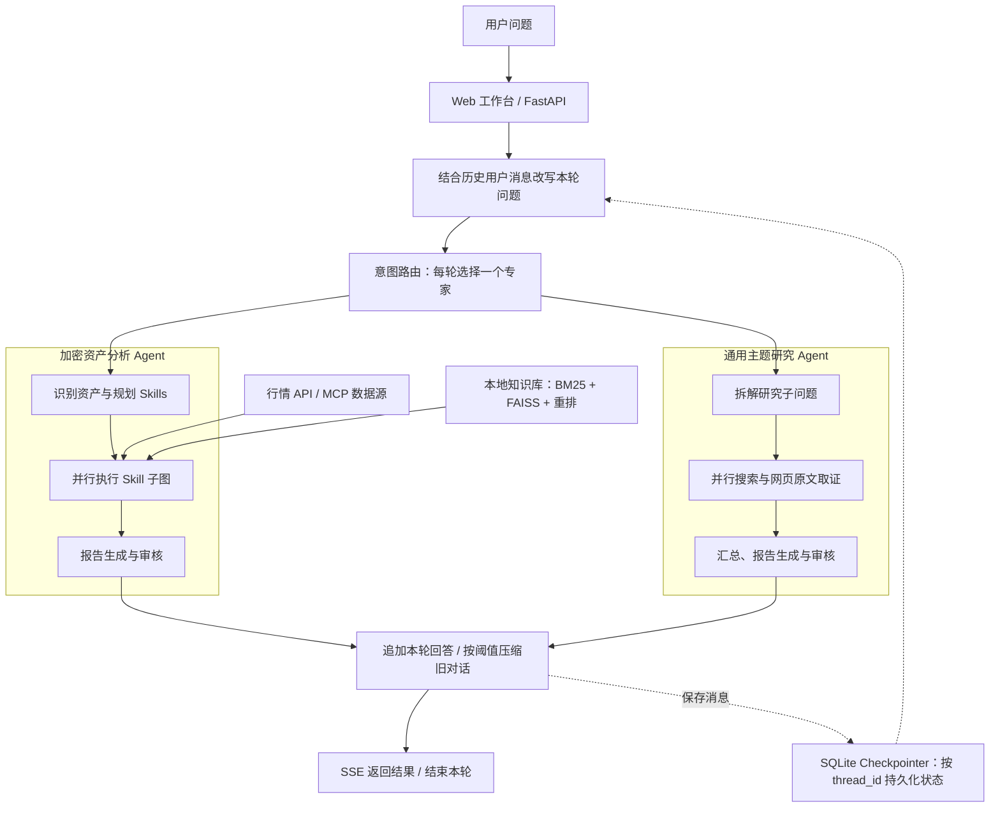

# Crypto Analysis Agent

基于 LangChain、LangGraph 的智能多 Agent 研究分析平台，将实时数据、网页原文与本地知识库组织为分析证据，生成可查看来源的研究报告。

支持两类任务：**加密资产分析**覆盖趋势、衍生品、ETF、情绪、流动性与美联储政策；**通用主题研究**支持问题拆解、并行搜索、网页取证与报告审核。Web 工作台提供执行进度、流式输出和中断续跑。

**技术栈：** Python · FastAPI · LangChain · LangGraph · Pydantic · MCP · FAISS · SQLite · SSE

[工程亮点](#工程亮点) · [功能演示](#功能演示) · [系统架构](#系统架构) · [评测结果](#评测结果) · [项目目录](#项目目录)

## 工程亮点

| 设计 | 实现与作用 |
| --- | --- |
| **规划与并行执行** | 根据问题选择 Skills，通过 LangGraph `Send` 并行执行子图，使用显式 State 与 Reducer 汇总结果，再进入报告生成和审核。[代码](app/crypto_analysis/crypto_analysis_parent_agent.py) |
| **模型与计算分工** | Skills 定义场景、工具和指标权重，Tools 取数，Python 完成指标计算、评分与表格渲染，模型负责规划、工具选择与解释。[Skill 定义](skills/) · [指标渲染](app/crypto_analysis/metric_renderer.py) |
| **混合检索与增量入库** | 中文 BM25 + FAISS 向量召回，经加权 RRF 融合与重排；按文件哈希同步新增、修改和删除。知识库支持分析解读，实时行情由工具获取。[代码](app/rag/) |
| **会话记忆与结果复用** | SQLite Checkpointer 按 `thread_id` 保存状态；历史摘要与近期消息用于问题改写，Skill 结果按会话和资产范围复用，显式刷新时跳过缓存。[记忆管理](app/memory/) · [Skill 缓存](app/crypto_analysis/skill_memory.py) |
| **流式交互与中断续跑** | SSE 展示执行阶段与报告正文；通过 `POST /api/resume` 恢复同一会话的检查点。重写报告时发送 `report_start`，前端清空旧稿后接收新内容。[代码](app/routing/service.py) |
| **追踪与评测闭环** | 按 Trace / Span 记录节点、模型用量与估算成本；采集节点输入输出，经筛选标注形成固定用例，结合规则、RAGAS 与浏览器端到端评测定位问题。[追踪](app/core/tracing.py) · [评测](eval_agent/) |

## 功能演示

### 加密资产分析示例

以下为一次 ETH 分析的实际运行截图，展示问题输入、执行阶段、报告正文及数据来源。点击图片可查看原图。

| 提问与执行进度 | 分析报告 | 数据来源与指标 |
| --- | --- | --- |
| <a href="docs/images/crypto-analysis-workbench.png"></a> | <a href="docs/images/crypto-analysis-report.png"></a> | <a href="docs/images/crypto-analysis-sources.png"></a> |

### 通用主题研究示例

以“分析一下人工智能”为例，展示问题输入、三个研究子问题的执行情况，以及包含来源链接的研究报告。点击图片可查看原图。

| 提问与执行进度 | 子问题与研究汇总 | 报告正文与来源引用 |
| --- | --- | --- |
| <a href="docs/images/topic-research-workbench.png"></a> | <a href="docs/images/topic-research-subquestions.png"></a> | <a href="docs/images/topic-research-report.png"></a> |

## 系统架构



主图流程为 `rewrite → router → 一个专家 → summarize_history → END`。两个专家使用独立的业务 State，完成后统一在主图追加回答、管理对话历史，并通过 SQLite Checkpointer 保存会话状态。

## 评测结果

### 节点与模块评测

| 环节 | 样本范围 | 结果 | 入口 |
| --- | --- | --- | --- |
| 路由 | 104 条 | 正确率 **98.08%**（102/104） | [routing](eval_agent/routing/run_eval.py) |
| 分析规划 | 114 条 | 资产识别 100%，Skill 选择 78.07%，刷新判断 100% | [planning](eval_agent/planning/run_eval.py) |
| 指标执行契约 | 116 条 | 工具名称、参数、证据关联、结果契约四项均为 100% | [calculate_metrics](eval_agent/calculate_metrics/run_eval.py) |
| Writer | 10 题 | 忠实度 0.7045，回答相关性 0.8817 | [writer](eval_agent/writer/run_eval.py) |
| Reviewer | 28 组历史报告 | 审核前后忠实度 **61.94% → 73.51%**，回答相关性 82.30% → 85.55% | [reviewer](eval_agent/reviewer/run_eval.py) |
| RAG | 156 题，142 条有效评分明细 | 忠实度 **87.85%**，回答相关性 84.63%，上下文精确率 89.42%，召回率 86.22% | [rag_retrieval](eval_agent/rag_retrieval/run_eval.py) |

规则评测检查历史输出，RAGAS 评估报告质量；指标契约通过率不代表公式与数值正确率，忠实度不代表事实准确率。

<details>
<summary>评测方式与有效样本数</summary>

- 路由、规划与指标执行读取历史输出，不重新调用模型或取数。
- Writer / Reviewer 对已保存报告评分；Writer 忠实度为 8 条有效评分、相关性为 10 条，Reviewer 忠实度为 23 组有效配对、相关性为 28 组。缺失评分不记为零分。
- RAG 实际执行检索、生成与评分；156 题中有 142 条有效评分明细，其余 14 题未见评分明细。

</details>

### 端到端评测

通过真实浏览器，在同一会话中连续提交 10 题，包含 4 组重复提问，检查任务完成、响应耗时及不同问法下的一致性。

**三轮均 10/10 完成、零重试；第三轮平均耗时 103.0s，综合评分 42.5/50。** 第三轮 ETF 语气与宏观数据一致性改善，仍存在单条回答内数字冲突、宏观加权分歧和缺少解释的内部评分。

报告：[首跑（10/21）](eval_agent/end_to_end/crypto_10q_evaluation_report_run1.md) · [二跑（10/21）](eval_agent/end_to_end/crypto_10q_evaluation_report_run2.md) · [第三轮（10/28）](eval_agent/end_to_end/crypto_10q_evaluation_report_run3.md)。评分依据页面可见回答与响应时长，满分 50 分；市场数据与服务版本在三轮间有变化，不据此归因某项改动的收益，也未据此验证多轮指代能力。

<details>
<summary>展开三轮完整对比与结论</summary>

| 指标 | 首跑 10/21 17:07 | 二跑 10/21 19:16 | 本轮 10/28 10:44 |
|---|---|---|---|
| 成功率 | 10/10 | 10/10 | 10/10 |
| 重试次数 | 0 | 0 | 0 |
| 平均耗时 | 118.7s | 143.0s | **103.0s** |
| 耗时极差 | 125.4s | 207.0s | **77.8s** |
| 总耗时 | 19 分 49 秒 | 23 分 49 秒 | **17 分 10 秒** |
| A 组（BTC 技术） | 🟢 | 🟢 | 🟢 |
| B 组（ETF 语气） | 🟡 漂移 | 🟡 漂移 | 🟢 **对齐** |
| C 组（ETH 衍生品） | 🔴 矛盾 | 🟢 对齐 | 🟡 轻度措辞差 |
| D 组（宏观） | 🔴 相反 | 🔴 相反 | 🟢 **数据统一，仅剩加权分歧** |
| 单条回答内部数字冲突 | 无 | 有（Q7：2.2% vs 2.0%） | 有（Q3：2355.36 vs 2350.36） |
| 黑箱内部评分 | 无 | 无 | **有（Q4、Q10）** |
| 综合评分 | 40.0 | 39.0 | **42.5** |

**一句话结论：** 三批里最好的一批。两个长期顽疾（B 组语气漂移、D 组宏观定性相反）都有实质改善，速度与稳定性也是三批最优；但「同一条回答内部数字打架」这个毛病连续两批都出现，只是换了个位置，说明还缺一道机械自检；黑箱评分则是这轮新冒出来的回退。

</details>

## 项目目录

业务编排位于 `app/`，提示词与 Skill 定义分别位于 `prompts/`、`skills/`，独立评测位于 `eval_agent/`。模型与运行参数见 [配置文件](app/core/config.py)。

<details>
<summary>展开目录结构</summary>

```text
crypto-analysis-agent/
├── api/                         FastAPI 入口与请求模型
├── app/
│   ├── core/                    配置、日志、追踪、执行预算与候选采集
│   ├── routing/                 问题改写、专家路由与 SSE 服务
│   ├── memory/                  对话历史压缩与近期消息保留
│   ├── crypto_analysis/         加密资产分析父图与 Skill 子图
│   │   ├── calculators/         指标计算与评分
│   │   ├── sources/             外部 API / MCP 数据源
│   │   └── tools/               业务工具与注册表
│   ├── topic_research/          主题研究 Agent 与状态
│   │   └── tools/               搜索与浏览器取证
│   ├── rag/                     文档处理、增量入库与混合检索
│   ├── llm/                     模型创建、调用与协议适配
│   ├── mcp_client/              MCP 连接与工具调用
│   └── cli.py                   知识库入库入口
├── prompts/                     业务提示词
├── skills/                      六个分析维度的 Skill 定义
├── static/                      Web 工作台与静态资源
├── data/                        本地文档、索引与会话数据
├── eval_agent/                  固定用例、候选、评测及结果
│   ├── routing/                 路由规则评测
│   ├── planning/                分析规划规则评测
│   ├── calculate_metrics/       指标执行契约评测
│   ├── writer/                  报告质量评分
│   ├── reviewer/                审核前后配对评分
│   ├── rag_retrieval/           检索与回答评测
│   ├── end_to_end/              三轮 10 题浏览器端到端评测报告
│   ├── candidates/              运行时采集的候选样本
│   ├── outputs/                 评测输出与结果
│   └── requirements.txt         独立评测环境依赖
├── tests/                       节点与数据源验证脚本
├── docs/                        项目文档资源
│   └── images/                  README 演示图片
├── .env.example                 环境变量示例
├── pyproject.toml               Ruff 检查与格式化配置
├── Dockerfile
├── compose.yaml
└── requirements.txt
```

</details>
